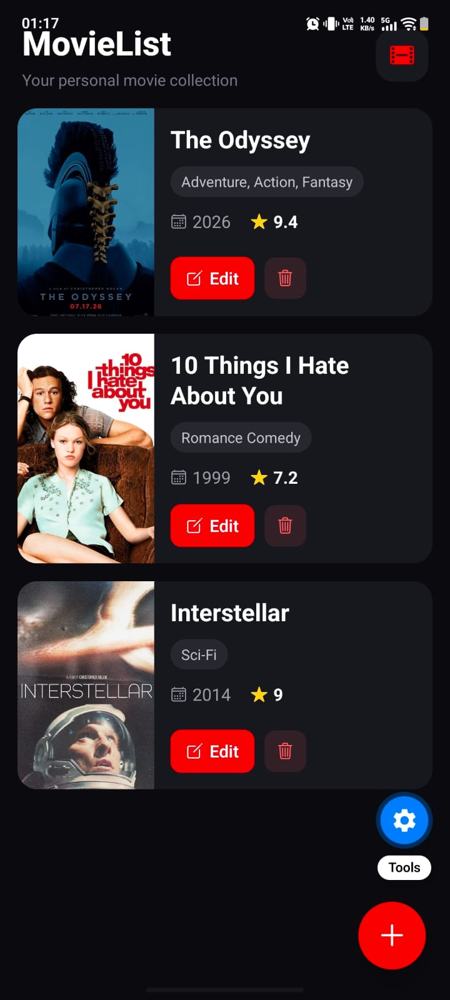
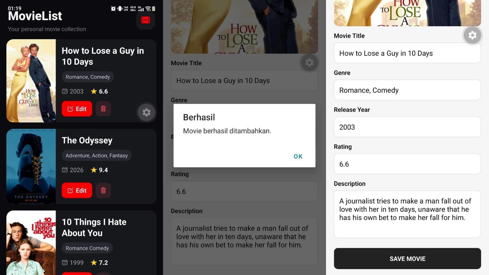
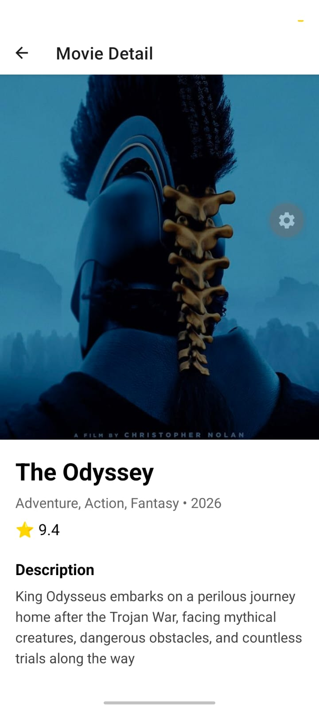
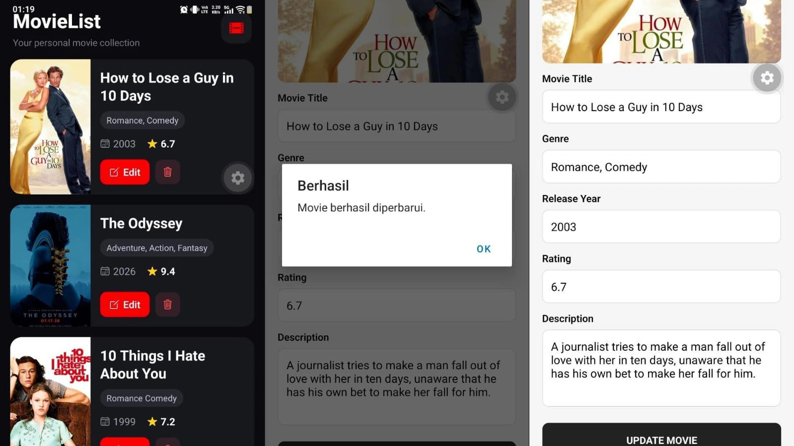

# 🎬 MovieList

MovieList adalah aplikasi mobile untuk mengelola koleksi film yang dikembangkan sebagai project UTS mata kuliah **IK300 Mobile Programming**.

Aplikasi menggunakan **React Native** sebagai frontend dan **Express.js** sebagai backend REST API, dengan **Prisma ORM** dan **MySQL** sebagai database.

## ✨ Fitur

- Menampilkan daftar film
- Menampilkan detail film
- Menambahkan film baru
- Upload poster film
- Mengedit data film
- Mengganti poster film
- Menghapus film
- Menampilkan genre, tahun rilis, dan rating
- Integrasi REST API dengan React Native

## 📱 Tampilan Aplikasi

### Home


### Add Movie


### Detail Movie


### Edit Movie


## 🛠️ Teknologi

### Frontend
- React Native
- Expo
- React Navigation
- Axios
- Expo Image Picker

### Backend
- Node.js
- Express.js
- Prisma ORM
- Multer
- CORS

### Database
- MySQL
- XAMPP

## 🔗 REST API

| Method | Endpoint | Fungsi |
|---|---|---|
| GET | `/api/movies` | Menampilkan seluruh film |
| GET | `/api/movies/:id` | Menampilkan detail film |
| POST | `/api/movies` | Menambahkan film |
| PUT | `/api/movies/:id` | Mengubah data film |
| DELETE | `/api/movies/:id` | Menghapus film |

## 📂 Struktur Project

```text
uts_individu_aisyah/
│
├── mobile/
│   ├── screens/
│   ├── services/
│   ├── App.js
│   └── package.json
│
├── movie-app-uts/
│   └── backend/
│       ├── controllers/
│       ├── routes/
│       ├── prisma/
│       ├── uploads/
│       ├── utils/
│       ├── server.js
│       └── package.json
│
├── screenshots/
├── .gitignore
└── README.md
```

## 🚀 Cara Menjalankan Project

### 1. Jalankan Database

Buka XAMPP dan jalankan MySQL.

Database yang digunakan:

```text
movie_app
```

### 2. Jalankan Backend

Masuk ke folder:

```bash
cd movie-app-uts/backend
```

Install dependency:

```bash
npm install
```

Jalankan server:

```bash
node server.js
```

Backend berjalan pada port:

```text
3000
```

### 3. Atur IP Backend di Mobile

Cari IPv4 laptop:

```bash
ipconfig
```

Kemudian buka:

```text
mobile/services/api.js
```

Sesuaikan:

```js
const API_URL = "http://IP-LAPTOP:3000";
```

Contoh:

```js
const API_URL = "http://192.168.1.10:3000";
```

### 4. Jalankan Mobile App

Masuk ke folder:

```bash
cd mobile
```

Install dependency:

```bash
npm install
```

Jalankan Expo:

```bash
npx expo start --lan -c --port 8082
```

Scan QR Code menggunakan aplikasi **Expo Go**.

> Laptop dan smartphone harus terhubung ke jaringan Wi-Fi yang sama.

## 📚 Implementasi Materi Course

Project ini mengimplementasikan materi:

- JavaScript ES6
- Express.js
- Prisma ORM
- MySQL
- RESTful API
- File Upload
- React Native
- Navigation
- API Integration
- CRUD Operations

## 👩‍💻 Author

Nama: Aisyah  
NIM: 2400792  
Kelas: KOM-5A  
Mata Kuliah: IK300 Mobile Programming

## 📌 Project

Project ini dibuat untuk memenuhi **UTS Individu IK300 Mobile Programming**.